# CG Motion

A timeline-based editor for CasparCG HTML templates. Free, runs locally, no subscription.

**Download:** Windows, Mac and Linux installers are under [Releases](https://github.com/regemarkfp/CG-Motion/releases/latest).

## Screenshots

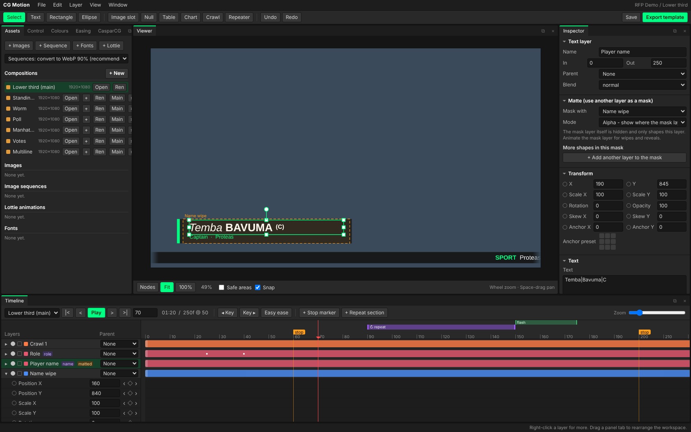 <i>The workspace: assets, viewer, inspector and timeline, with keyframes, stop markers and invokes.</i>

<table>
<tr>
<td width="50%" valign="top">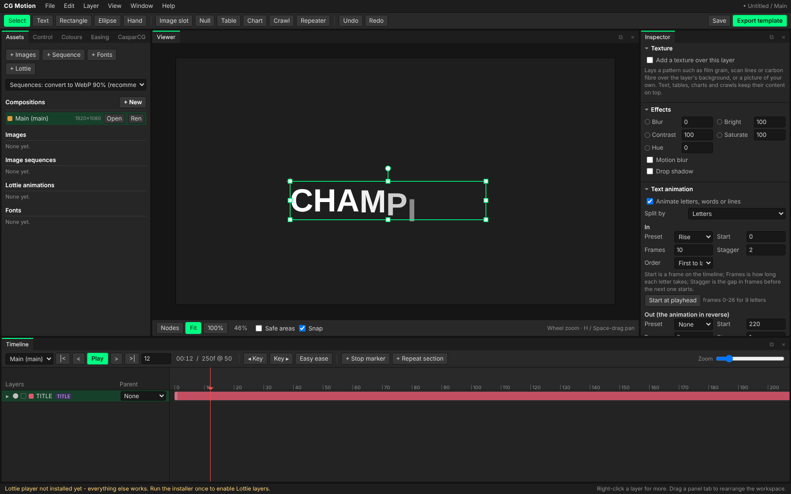 <b>Text animation</b> Letters, words or lines rise, drop, fade, blur or type in one after another, with stagger and order.</td>
<td width="50%" valign="top">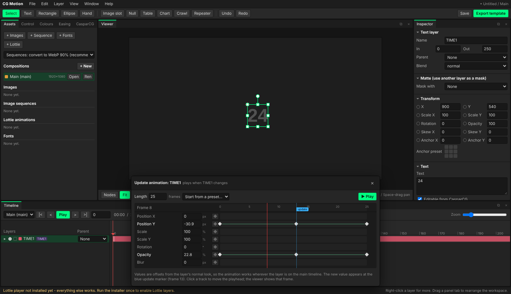 <b>Update animations</b> Presets or your own keyframes on each layer's update timeline, played when CasparCG sends a new value.</td>
</tr>
<tr>
<td width="50%" valign="top">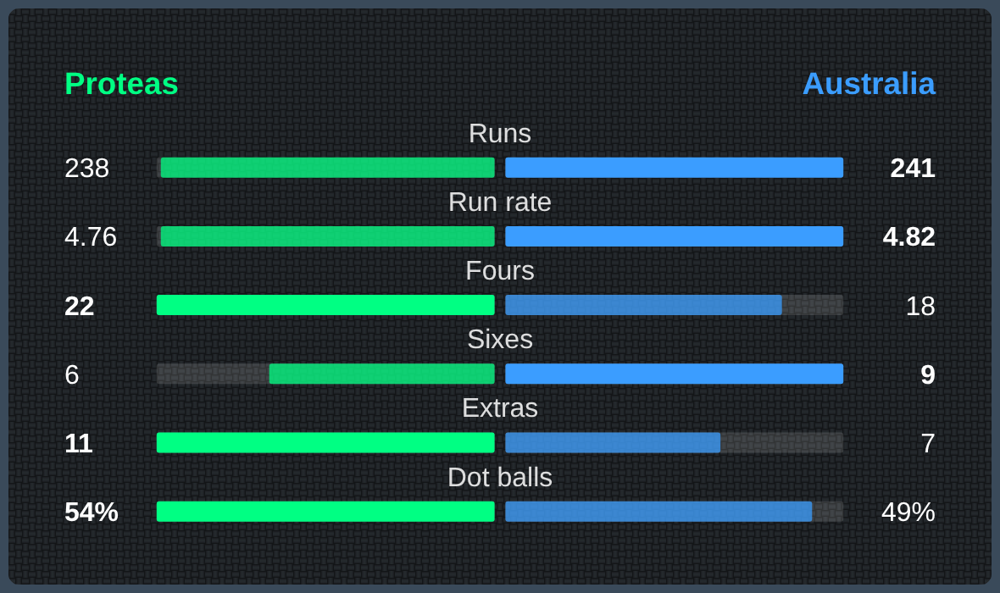 <b>Stat comparisons</b> Double bars for head-to-head stats, every value a CasparCG field.</td>
<td width="50%" valign="top">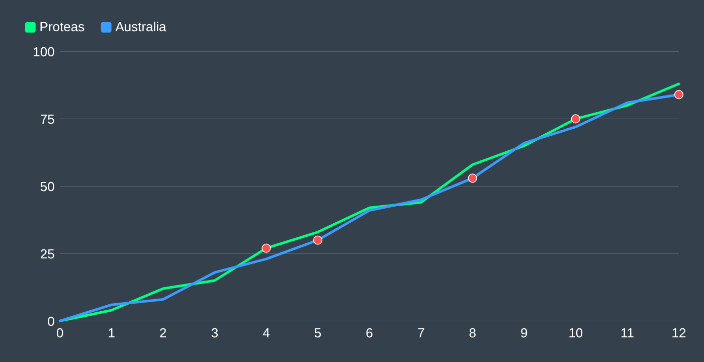 <b>Charts</b> Worms, manhattans, bars, pies and donuts that draw on and update live.</td>
</tr>
<tr>
<td width="50%" valign="top">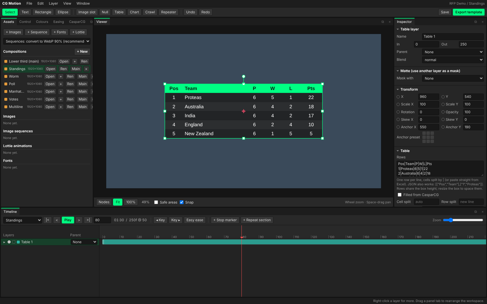 <b>Tables</b> Standings and scorecards with rows that animate in; paste straight from Excel.</td>
<td width="50%" valign="top"> <b>Text styles</b> One field, several looks: John|Smith|C becomes a thin first name, bold SURNAME and a raised (C).</td>
</tr>
<tr>
<td width="50%" valign="top">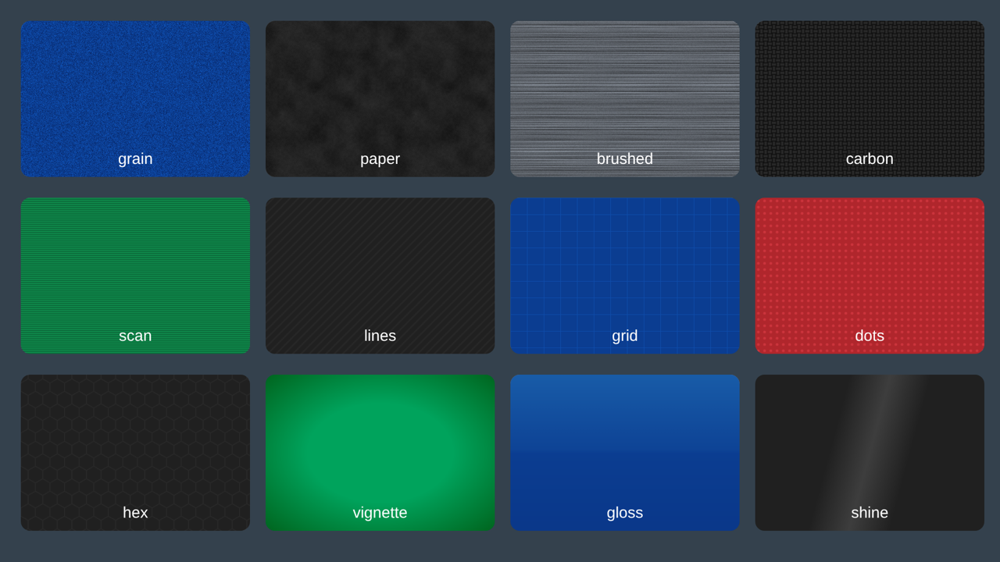 <b>Textures</b> Grain, carbon, halftone, gradients and more, animated and maskable.</td>
<td width="50%" valign="top">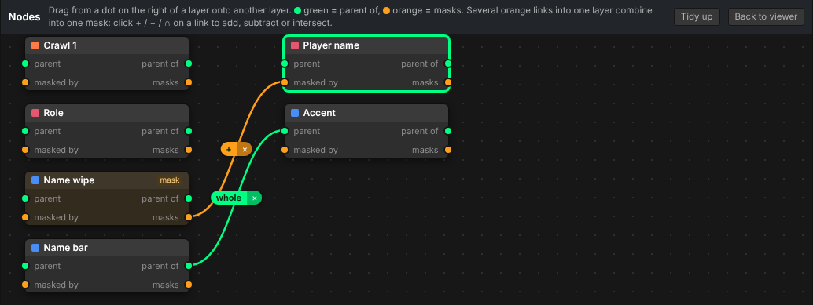 <b>Nodes</b> Parent and mask layers by dragging links between them.</td>
</tr>
<tr>
<td width="50%" valign="top">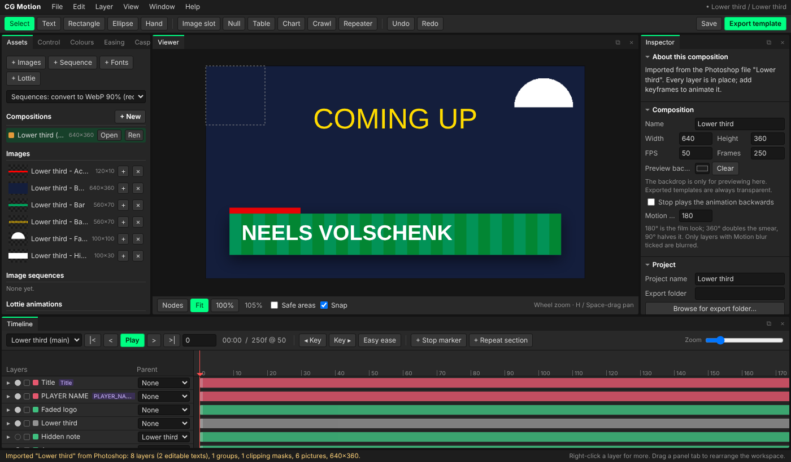 <b>Photoshop and Affinity import</b> Layered .psd and Affinity files come in with groups, text fields and masks in place.</td>
<td width="50%" valign="top">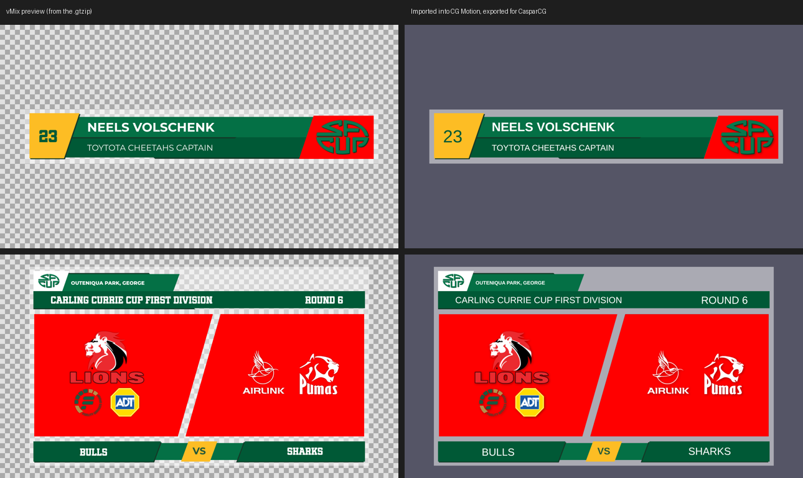 <b>vMix and Loopic import</b> Bring existing vMix GT titles and Loopic projects across to CasparCG.</td>
</tr>
<tr>
<td width="50%" valign="top">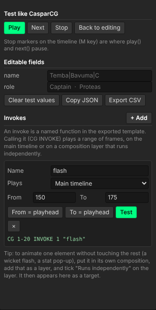 <b>Test like CasparCG</b> Play, Next, Stop, invokes and every field with test values, before going on air.</td>
<td width="50%" valign="top">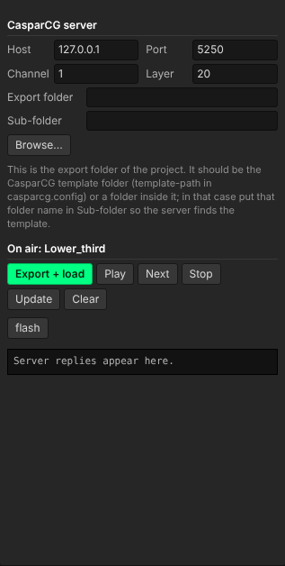 <b>Straight to the server</b> Export to the template folder and play on a running CasparCG server.</td>
</tr>
</table>

More in the [user guide](docs/CG%20Motion%20Guide.pdf).

## Start

### As a Windows program (.exe)

1. Install Node.js (LTS) from https://nodejs.org if you don't have it.
2. Double-click **Build CG Motion.bat**. The first build downloads the build tools and takes a few minutes; later builds are quicker.
3. The `dist` folder opens with two files:
   - **CG Motion Setup 1.0.exe** installs CG Motion with Start menu and desktop shortcuts, and makes `.cgm` project files open in CG Motion when double-clicked. Uninstall it from Windows Settings > Apps like any program.
   - **CG Motion 1.0 Portable.exe** runs without installing (it unpacks itself each time, so it starts a few seconds slower). Handy on a USB stick or a playout machine.

The program, installer and uninstaller carry **RegemarkFP** as publisher and copyright holder.

**Signing as RegemarkFP.** Double-click **Create RegemarkFP certificate.bat** once (Windows asks you to confirm trusting it: click Yes). From then on **Build CG Motion.bat** signs CG Motion with it. This is your own certificate, so only PCs that trust it show "RegemarkFP" as the verified publisher: on another PC, run **Trust RegemarkFP.bat** (copied into `dist` next to `RegemarkFP.cer`) once. Keep `build\RegemarkFP.pfx` and `build\RegemarkFP-password.txt` private, and back them up: a new certificate is a different publisher as far as Windows is concerned.

Windows SmartScreen ("Windows protected your PC") only checks files that were downloaded from the internet or email; a certificate you made yourself does not remove that warning. If it appears, click **More info** > **Run anyway**. Removing it everywhere needs a code-signing certificate bought from a certificate authority. Recent projects, the panel layout and other settings are shared between the installed app and the folder version.

After updating the CG Motion files, run **Build CG Motion.bat** again and install the new Setup over the old one; your settings are kept.

### As a Linux program (AppImage and .deb)

On a 64-bit Linux PC with Node.js 20 or newer, run `bash build-linux.sh` in the CG Motion folder. The `dist` folder then has:

- `CG-Motion-<version>-x86_64.AppImage` runs without installing (`chmod +x` it first). On Ubuntu 24.04 and newer, start it with `--no-sandbox` if it closes straight away.
- `CG-Motion-<version>-amd64.deb` installs CG Motion with a menu entry and `.cgm` file type: `sudo apt install ./dist/CG-Motion-<version>-amd64.deb`.

From the folder, `bash start-cg-motion.sh` runs CG Motion without building (add `--safe` for safe mode). GitHub also builds both Linux files on every upload (see below), so a Linux PC is not needed to make them.

### From the folder (while working on the app)

Double-click **Start CG Motion.bat**. The first run downloads the app shell (Electron), the Lottie player and the build tools; after that it opens straight away.

### On GitHub (automatic builds)

- **Publish to GitHub.bat** uploads the project to https://github.com/regemarkfp/CG-Motion (Git for Windows needed; sign in once). Run it after every update.
- GitHub then builds the Windows installer and portable app, the Linux AppImage and .deb, and the Mac .dmg and .zip by itself (`.github/workflows/build.yml`): open the repository's **Actions** tab, click the latest run, and download **CG-Motion-Windows**, **CG-Motion-Linux** or **CG-Motion-macOS** under Artifacts.
- To publish a version: when Publish to GitHub.bat asks for a version, type e.g. `1.1`. GitHub builds `CG Motion Setup 1.1.0.exe`, `CG Motion 1.1.0 Portable.exe`, `CG-Motion-1.1.0-x86_64.AppImage`, `CG-Motion-1.1.0-amd64.deb`, the Mac `.dmg` files and the guide, and puts them under **Releases** on the repository page.
- To have GitHub sign them as RegemarkFP, run **Let GitHub sign CG Motion.bat** once and follow its two steps (it copies the certificate and its password for the repository's secrets `REGEMARKFP_PFX` and `REGEMARKFP_PASSWORD`). Without the secrets the builds are simply unsigned.

## Projects

The app opens on a start screen with your recent projects. *New project* asks for a name, a project folder, the first template's name, size, frame rate and length. The project file is saved in that folder, and **Export template** writes the composition you have open into the same folder as `<composition name>.html`, with no dialog. Each composition is its own template and only carries the fonts, pictures and nested compositions it uses. **Dup** in the Compositions list (or Ctrl+Shift+D) duplicates a composition with its whole timeline, optionally with its own copies of the pre-comps inside it; right-click a pre-comp layer > Make composition unique gives just that layer its own copy. The folder can be changed later (select nothing, then Project in the inspector).

### Opening Loopic projects

**File > Import Loopic project (.loo)** (or plain *Open*) reads a Loopic project and turns it into a CG Motion project: every composition, layer, keyframe and easing curve, the embedded fonts, pictures and image sequences, masks, nested compositions, image loaders and text fields. The `.loo` file is not changed; use *Save* to keep the result as a `.cgm`.

Loopic code is not run. The common patterns are converted instead:

- `this.pause()` on a frame becomes a stop marker, and a jump back (`this.goToAndPlay(0)` on the last frame) becomes a repeat section.
- `loopic.useOnInvoke("name", () => this.goToAndPlay(N))` becomes an invoke that plays from frame N to the next stop marker. In a nested composition that runs on its own playhead it drives that copy.
- `loopic.useOnUpdate` that sets a fill, colour, background or opacity of an element becomes a field mapped to that property.
- The first name / surname pattern (`value.split("||")` with a styled ``) becomes the text's **Second style**: send `John||Smith` and the part after the separator uses the second font.
- `loopic.useOnStop` playing in reverse becomes *Stop plays the animation backwards* in the composition settings.

Anything else is listed in the report shown after the import so you can rebuild it. Masks clip to the mask's shape (its colour and opacity are ignored) and several masks on one layer intersect. Compare each template with the original before going on air.

### Importing vMix titles

**File > Import vMix titles (.gtzip)...** (or the start screen button) turns vMix GT titles into compositions; select several at once and each becomes its own composition in one project. Layout, pictures, text (font, size, weight, alignment, Uppercase, Shrink), masks, crops, skew and shadows come across; the In storyboard plays to a stop marker and the Out storyboard plays on CG NEXT / STOP (Fly, Fade, Zoom, Expand, Reveal as keyframes, with objects hidden outside their vMix layer while they fly). Text objects become fields named after the vMix object (spaces become `_`), image objects become replaceable pictures, data rectangles become colour fields. A .gtzip has no fonts: add them under Assets > Fonts or install them on the CasparCG PC. The report shows vMix's previews to compare.

### Importing Photoshop files

**File > Import Photoshop file (.psd)...** (or open a .psd / .psb) turns a layered file into a composition at the document's size. Pixel layers become pictures in place (opacity, blend mode, visibility kept), groups become nulls their layers follow, text layers become editable text fields named after the layer, layer masks are baked in, clipping masks become mattes and drop shadows come across. RGB, CMYK, greyscale and indexed files in 8/16/32 bit are supported. After Effects and DaVinci Resolve/Fusion files can't be read directly yet; opening one explains the Lottie / PNG-sequence / PSD routes.

### Importing Affinity files

**File > Import Affinity file (.af, .afphoto, .afdesign)...** (or open the file) reads Affinity Photo, Designer and Publisher documents (versions 1-3, including Affinity by Canva's .af) directly. Each artboard becomes a composition; layers and groups become nulls; text becomes editable fields; plain rectangles and ellipses become editable shapes; other vectors, gradients and masked artwork are drawn into pictures; pixel layers and placed images become pictures. Drop shadow and Gaussian blur map onto the layer's shadow and blur; colour overlay and outline are baked in. Large groups of plain vector art become one picture each. The report shows Affinity's own preview for comparison; if a file can't be read, that preview is imported instead. The reader (app/js/affinity.js, afmodel.js, afimport.js, zstd.js) follows the public afread and vectorcraft descriptions; see NOTICE.md.

### Smooth playback

- **Optimise sequences for playback** (File menu, or the button in the Assets tab) cuts every frame of an image sequence down to the area that has pixels. Broadcast sequences are usually full 1920x1080 pictures with a small graphic in them, and unpacking those every frame is what makes a template stutter. The picture is identical. Sequences you import are optimised automatically; Loopic imports offer it in the import report.
- On air, frames of optimised sequences are unpacked ahead in the background.
- In CasparCG, turn on GPU rendering for HTML: in `casparcg.config`, inside `<html>`, set `<enable-gpu>true</enable-gpu>`, then restart the server.
- What costs most, in order: full-frame image sequences, blur / drop shadow / motion blur on large layers, many masks, animated width and height of text boxes. Position, scale, rotation and opacity are cheap.

### Motion blur

Tick **Motion blur** under Effects on a layer. It is blurred along the way it travels (its own position, scale and rotation and its parents'), only while moving, and is sharp again when the template holds on a stop marker. The strength is the composition's **shutter angle** (180° = film look, 360° = double). Each blurred layer costs some playback speed, so use it on the fast movers.

### Tutorial project

**Tutorial project** on the start screen (or **Help > Open the tutorial project**) opens an example project with one graphic per composition: a player lower third with a crawl, a standings table, a worm, a manhattan, a poll donut, vote bars, a head-to-head stat comparison and a multiline quote. Click an empty spot in the viewer to read each composition's notes in the Inspector. It opens as a new, unsaved project, so the copy that ships with the app is never changed. The file is `app/tutorial/CG Motion Tutorial.cgm`.

## Workspace

- **Panels**: Viewer, Timeline, Inspector, Assets, Control, Colours, Easing and CasparCG are panels. Drag a panel's tab onto another panel to tab them together, or towards an edge of a panel to split it. Drag the dividers to resize. The x closes a panel; the Window menu brings it back and has *Reset layout*. The layout is remembered.
- **Moving panels**: drag a panel's tab. Nothing moves until you let go; a blue highlight with a label ("Tab with Inspector", "Dock below Viewer", "Dock along the right of the workspace") shows exactly where it will land. Drop on a panel's middle or tab strip to tab with it, near one of its edges to split it, or at an outer edge of the workspace to span that whole side.
- **Floating windows**: the small window icon on a panel pops it out into its own window, which you can move to another screen; letting go of a dragged tab outside every window does the same. To dock a floating panel, drag its tab over the main window and drop it on the highlight. *Dock* in the floating window, or closing it, puts the panel back in the side group.
- **Colours**: every colour shows its hex code, which you can type or paste (`#RRGGBB`, or `#RRGGBBAA` to include opacity). Click the swatch for the picker: colour square, hue and opacity sliders, hex and R G B A boxes, basic, shared and recent colours, Transparent, and Pick from screen.
- **Menus**: File, Edit, Layer, View and Window hold every command with its shortcut. The strip below keeps the tools, Undo / Redo, Save and Export.
- **Selecting layers** in the timeline: Shift + click selects every layer between the last clicked one and this one, Ctrl + click adds or removes one, Ctrl + Shift + click adds a range.
- **Right-click** a layer in the timeline or the viewer for rename, duplicate, delete, show / hide, lock, order, repeater and pre-compose.
- **Inspector sections** fold when you click their title and stay folded.
- **Text**: alignment (left, centre, right, justify; top, middle, bottom) and bold / italic are buttons, as in a word processor. **Convert case** switches between as typed, ALL CAPS, lowercase and Capitalise Each Word. Text has a background fill, an outline drawn outside its frame, and a corner radius.

## Text, tables, charts and crawls

- **Multiline text:** press Enter in the text, or send `\n` in the CasparCG field (the *Line break code* can be changed). On a text box, *Shrink the text until every line fits the box* makes long text smaller instead of spilling out.
- **Text styles:** split a text at an invisible separator and give every part its own font, weight, italic, size, colour, case, raise (superscript) and text before / after it. The **Name SURNAME (C)** preset turns `John|Smith|C` into a thin italic first name, a bold SURNAME and a small raised (C); send `John|Smith` and the captain mark is left out. Works in text layers, table cells and crawl items.
- **Table** (toolbar): one row per line with cells split by `|`, or paste straight from Excel, or JSON. Header row, row / alternate fills, lines, column widths and alignment, and rows that fade, slide or drop in one by one. Fill it from CasparCG by ticking *Filled from CasparCG*.
- **Chart** (toolbar): line (worm, with *Add up the values* for runs per over), bars (manhattan), horizontal bars, double bars for stat comparisons (`Proteas | Australia` then `Fours: 22 | 18`, as two bars from the middle or one split bar per stat), pie and donut. Data is one series per line, `Proteas: 4, 8, 3, 12w` (w = wicket, drawn as a dot), or `Yes: 62` per item for pies and bars. Charts draw on from their In frame, or keyframe *Progress*.
- **Crawl** (toolbar): items split by `|` scroll right to left with a separator between them (a character in its own colour, or a picture such as a logo). Each item can be styled with Text styles using a second separator, e.g. `SPORT^Proteas win by 5 wickets`. On air it keeps running while the template holds on a stop marker.
- **Data panel** (Window > Data, or *Edit in the Data panel* in the Inspector): a grid beside the timeline for the selected table, chart or crawl. Add, remove and move rows, columns, series, points, stats and items with buttons, set column widths, alignment and colours, press Enter to go down a cell, and paste a block straight from Excel.
- **Everything is controllable from CasparCG:** new tables, charts and crawls are *Filled from CasparCG* straight away (older projects get a field name when they open). The main field (e.g. `standings`) replaces all the data. With *Every cell as its own field too* (on by default) single values can be changed without sending the whole table:

  | Layer | Fields (numbers start at 1) |
  |---|---|
  | Table | `standings_h2` header cell 2 · `standings_r3c2` row 3, cell 2 · `standings_r6` a whole row (`6\|Pakistan\|6\|1\|6`), adds rows too |
  | Line / bar chart | `worm_n1` series name · `worm_v1` all its values (`4, 8, 3w`) · `worm_v1p13` point 13 only · `worm_c1` colour |
  | Pie, donut, horizontal bars | `poll_n2` item name · `poll_v2` its value · `poll_c2` colour |
  | Double bars | `stats_n1` / `stats_n2` names · `stats_s3` stat 3 label · `stats_a3` / `stats_b3` its values · `stats_c1` / `stats_c2` colours |
  | Crawl | `crawl_i2` item 2 |

  Point at a cell in the Data panel to see its field name. They are all in the Control panel, the field list in the exported template, and **Export CSV** for RFP Manager. Chart type, scale maximum, colours, suffix, legend and running total, and a table's header row and column widths, can also be linked to fields with *Link to a field*.
- **Textures:** tick *Add a texture over this layer* on a shape, text, table, chart or crawl background. Choose grain, paper, brushed metal, carbon, scanlines, diagonal lines, grid, dots, hex, vignette, gloss or shine, or your own picture (tiled, cover or stretched). Set blend, opacity, size, stretch, angle and pattern colour. On text, tables, charts and crawls the texture sits under the content so the text stays clean.
  - **Halftone, gradients and radial:** halftone dots that grow from nothing to solid (straight at any angle, or radial from the centre; round, square, diamond or line dots; start / end coverage, curve, staggered rows), a two-colour gradient, a radial glow, rays (sunburst) and rings. Every texture is endless: it fills the layer whatever the offset, scroll, zoom or angle.
  - **Refine** (all keyframeable): offset X / Y, zoom, turn, brightness, contrast and soften, plus invert and black and white.
  - **Motion:** scroll (direction and speed), back and forth (distance, seconds, smooth or even), flicker (random jumps, like film grain), circle round, plus spin and pulse. One-click presets: Slow drift, Scanline roll, Film flicker, Sway, Shine sweep, Breathe, Still. For your own motion, keyframe the offset, zoom and turn with any ease. Motion keeps running on air, also during holds.
  - **Where it shows:** fade to soft edges, strongest at the top / bottom / left / right / middle / outside, or **mask the texture with other layers** like a layer mask (add, subtract, intersect, invert). Mask layers are hidden and can be animated for texture wipes.
  - **Presets:** *Apply a preset...* (built-in looks, your own, and this project's), *Save as preset* (kept on this PC for every project and in the project), *Delete...*.
  - **Sizing:** sliders for Size, Width, Height and Angle (double-click resets), Variation for grain / paper / brushed, Hue and Saturate in Refine, *Pinned to* the layer or the composition, and Insets from each edge.
  - **Texture field:** tick *Control this texture from CasparCG* and name it (e.g. `texture1`): send 1/0 to show/hide, a preset name to switch, JSON for several settings, or single fields `texture1_kind`, `_preset`, `_opacity`, `_size`, `_width`, `_height`, `_angle`, `_zoom`, `_x`, `_y`, `_color`, `_blend`, `_motion`, `_speed`, `_dir`, `_pic`, `_hue`, `_sat`.
  - **CasparCG:** every texture setting can be linked to a field (on / off, type, a picture path or URL, blend, size, motion, speed, direction, opacity, offset and more) from the *CasparCG* row in the Texture section.

## Small things worth knowing

- **Shadows** fall outside a layer's own mask and crop mask. A composition layer clips its content to its frame unless *Show outside its frame (shadows, overshoot)* is ticked.
- **Parenting** passes on position, rotation and scale, not skew: a skewed parent leaves its children upright.
- **Hand tool** (H) drags the view around; with it two-finger scrolling pans and pinching zooms. *View > Trackpad scrolling* makes two-finger scrolling pan with every tool.
- **The guide** ships as `CG Motion Guide.pdf` next to the program (and next to the exes in `dist`); *Help > Open the guide* or F1 opens it. To refresh it after the Claude Docs guide changes: export the guide as markdown to `docs/guide.md`, then run `python3 test/make_guide_pdf.py` and `node test/make_guide_pdf.js`.

## How a template works

- **Layers**: text, rectangles/ellipses, images, image sequences, Lottie animations, nested compositions and nulls. Add text and shapes with the tools above the viewer; import everything else in the **Assets** tab.
- **Animate**: click the round stopwatch next to any property (inspector or timeline) to keyframe it. Change the value at another frame and a keyframe is added. Select keyframes and use the **Easing** tab to shape the curve or apply a preset. Presets are linked: edit a preset and every keyframe using it follows.
- **Editable text**: tick *Editable from CasparCG* on a text layer. It gets a field name (f0, f1, ...) that the CasparCG client fills in. *Fit width* squeezes long names so they never overflow.
- **Transparency**: every colour has an opacity slider and % box beside its swatch (0 = fully transparent), and the swatch shows a checkerboard through it. Opacity is part of the colour, so it keyframes with it. From CasparCG, send 8-digit hex (`#rrggbbaa`), `rgba(...)` or `transparent`.
- **Shared colours** (Colours tab): add a colour, then link any text colour, fill or stroke to it (buttons in the tab, or the drop-down beside each colour in the inspector). Change the shared colour and everything linked follows. Tick *From CasparCG* to give it a field name; the operator can then send `#rrggbb`, `rgb(...)` or a colour name such as `gold`.
- **Image slots** (toolbar button): an empty picture box that CasparCG fills, for team logos, flags or headshots. Send a path or web address in its field. Set *Before* `logos/` and *After* `.png` and the operator only sends `SA` to load `logos/SA.png` from beside the template. A missing file simply shows nothing.
- **CasparCG variables** (bottom of the inspector): map any property of a layer (position, size, scale, rotation, opacity, colours, blur, mask, visibility, font, and more) to a field name. Numbers can replace, add to or multiply the designed value, and *Glide* eases to a new value over a set number of frames on air. On/off properties accept 1/0 or true/false.
- **Text boxes**: the Text tool makes a text box (click for a default size, drag for your own). The handles and the Scale values resize the box and the text keeps its size, laid out inside: Align (left, centre, right, justify), Vertical (top, middle, bottom), wrap onto new lines or stay on one line and squeeze to fit, and optionally clip to the box. Untick *Text box* for plain text that grows with its content (needed when other layers are pinned to the text's edge); pulling a side handle of plain text turns it back into a box.
- **Text margins**: Left / Right / Top / Bottom in the Text section pad the text box. They count towards Fit width, Wrap width and anything following the box.
- **Parenting**: with a parent set, the *Pin to parent* box (same idea as Premiere's responsive pinning) decides how the layer follows. Click the centre square for the whole object (move, rotate, scale). Click an edge line to follow only that edge, so a score box sits just past a name of any length. On shapes and pictures, pinning opposite edges (left + right, top + bottom) makes the layer stretch with the parent while keeping its current overhang, which gives a plate that always hugs a text.
- **Snapping**: moving or resizing in the viewer snaps to the frame edges and centre, the safe areas when shown, and the edges and centres of other layers, with pink guide lines. Untick *Snap* under the viewer or hold Ctrl to switch it off.
- **Skew**: Skew X and Skew Y sit with the other transform properties, keyframe like them and can be mapped to CasparCG fields.
- **Nodes** (button under the viewer): every layer of the open composition as a box. Drag from the blue dot on the right of a layer onto another layer to make it that layer's parent; drag from the orange dot to use it as a mask for that layer. Several orange links into one layer combine into a single mask: click the + on a link to switch it between add, subtract (cut a hole) and intersect. The x on a link removes it. Layers can be dragged around and *Tidy up* lays them out again. The same combined mask can be edited in the inspector under Matte.
- **Repeater** (toolbar): select the layers that make one row (or column), click Repeater and name it. They become a small composition that is repeated; set Copies, Direction (down or across), Spacing in pixels and Stagger (frames of delay per copy) under Composition layer in the inspector. Every copy looks and animates the same but has its own fields: a field `name` inside becomes `name1`, `name2`, ... and plain `name` sets all copies at once. Type `{#}` in any text for the copy number. An optional field sets how many copies show on air. Double-click the repeater to edit the row; every copy follows.
- **Matte**: in the inspector, *Mask with* lets any layer (shape, text, image, sequence, Lottie, composition) act as the mask for another, in alpha, inverted alpha or luma mode.
- **Stop markers** (M key): `play()` runs to the first marker, `next()` to the following one, `stop()` plays from the last marker to the end and clears.
- **Invokes** (Control tab): named functions that play a frame range. Target the main timeline, or a composition layer set to *Runs independently* so it animates without disturbing anything else. Call them with `CG 1-20 INVOKE 1 "name"`.
- **Repeat sections**: *+ Repeat section* (timeline bar) adds a purple band on the ruler at the playhead; drag it to move, drag an end to resize, double-click to delete. On air, playback circles inside the band until `next`, `stop` or another invoke lets it out, then carries on. A band in the main composition works with play / next / stop; a band inside a composition that "runs independently" works with that composition's invokes (one invoke plays in and loops, a second plays out). A composition layer that is not invoke-driven also has its own Playback setting (once, loop, back and forth).
- **CSV of variables**: *Export CSV* in the Control tab writes `<composition name>.csv` into the project folder: one row per field (name, type, default, which layer it drives, copy number for repeaters) and one row per invoke.
- **Test**: the Control tab has Play / Next / Stop, field inputs and a Test button per invoke, all running the same code as the exported file.
- **Export template** writes one self-contained .html (fonts, images, sequences and Lottie inside). Copy it to your CasparCG template folder. The exported file can be re-opened in CG Motion.
- **CasparCG tab**: set host, port, channel/layer and your template folder to export and trigger the template on a running server.

To check an exported file in Chrome, open it and add `#preview` to the address: P = play, N = next, S = stop.

## Shortcuts

Space play/pause · , . step frame · J K previous/next keyframe · M stop marker · F9 easy ease · U show/hide layer properties
V T R O tools · arrows nudge (Shift = 10) · Ctrl+D duplicate · Ctrl+Shift+C pre-compose · Ctrl+[ ] layer order
[ ] move layer start/end to playhead · Alt+[ ] trim · Ctrl+C/V copy/paste layers or keyframes · Del delete · Ctrl+Z / Ctrl+Shift+Z undo/redo · F12 developer tools

**Viewer:** wheel zooms at the mouse · horizontal / tilt wheel, trackpad swipe or Shift + wheel scroll left and right · Space + drag or middle-drag pans · **Fit** (lit while on) keeps the composition fitted whenever the viewer changes size; zooming or panning switches it off, click Fit to switch it back on.

## Notes

- Fonts are named after their file (Montserrat-Bold.ttf becomes "Montserrat-Bold"). Import each weight you need.
- Image sequences live inside the template, so keep them short; the WebP option on import cuts size a lot.
- Lottie: import the Lottie JSON export (not .lottie). Text layers in the Lottie can be given field names.

### If CG Motion opens to an empty window

After 12 seconds without the editor appearing, CG Motion offers to restart without graphics acceleration (remembered), reset the panel layout, or show the error details. A graphics-driver crash restarts it without acceleration automatically. `Start CG Motion (safe mode).bat` starts without acceleration and with the default layout. Startup errors show in a red box; the log is `%APPDATA%\cg-motion\cg-motion.log`; delete `no-gpu` in that folder to turn acceleration back on.

### Variables sheet (PDF)

File > Export variables sheet (PDF, all templates)... (or Export PDF in the Control panel) makes one PDF for the project: per template a still frame at its hold point, its fields, cell fields and invokes, and a ready CG ADD command with the default data.

### Fonts embedded on export

Exporting embeds every font a template's text uses (each weight and italic) from the fonts installed on the PC (fontindex.js indexes Windows' system and per-user font folders, cached in the user data folder). Fonts under Assets > Fonts take priority; fonts that aren't installed or whose licence forbids embedding (OS/2 fsType restricted) are listed in the status bar.

### Exporting from a pre-comp

Export template (Ctrl+E) and the CasparCG panel write the template the open composition belongs to: every top-level composition that uses it. File > Export this composition on its own writes just the open composition.

### Field suffix on composition layers

A composition layer's Field suffix (e.g. _L) is added to every field name inside it (TIME1 -> TIME1_L), so two pre-comps with the same field names get their own fields; the plain name still fills copies without their own value. The Control panel detects clashing pre-comps and offers "Give each its own fields". Renaming a layer renames its field when the field still carries the layer's name.

### Update animations

Layers with a field have an Update animation (Inspector): presets (fade, slides, pop, flip, flash, count) or custom keyframes on the layer's own update timeline (app/js/updanim.js), with channels as offsets (position, scale, scale Y, rotation, opacity, blur) and an update marker for the frame where the new value appears. The runtime plays it on UPDATE when a field's value changes (Player.updated / updFx / held values in runtime.js).

### Text animation (letters, words, lines)

Text layers have a Text animation section (Inspector): split by letter, word or line, with In and Out presets (rise, drop, fade, slide, scale up, zoom out, blur, typewriter, flip, spin), frames per unit, stagger and order (forward, backward, centre, edges, random). The update animation also has a Per letter / word option that takes the old text out unit by unit and brings the new text in. In runtime.js: splitUnits / unitPose / taPose, and the 'units' preset in Player.updated.

### Rebuilding the guide PDF

`python3 tools/make_guide_html.py && node tools/make_guide_pdf.js` builds `docs/CG Motion Guide.pdf` from docs/guide.md, with the pictures from docs/images (index.json maps each caption to its file).
